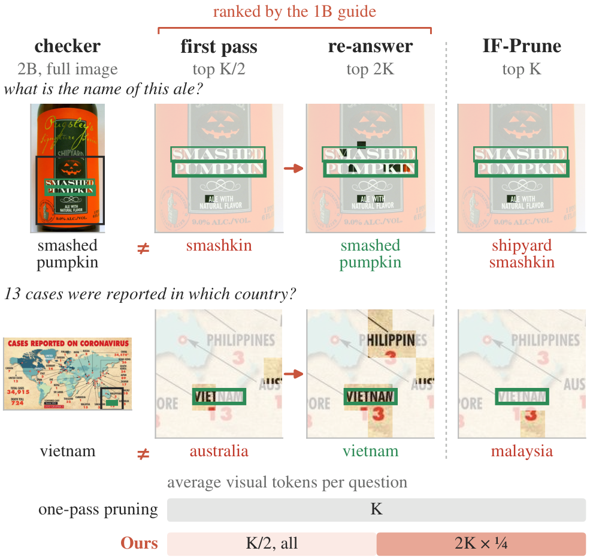
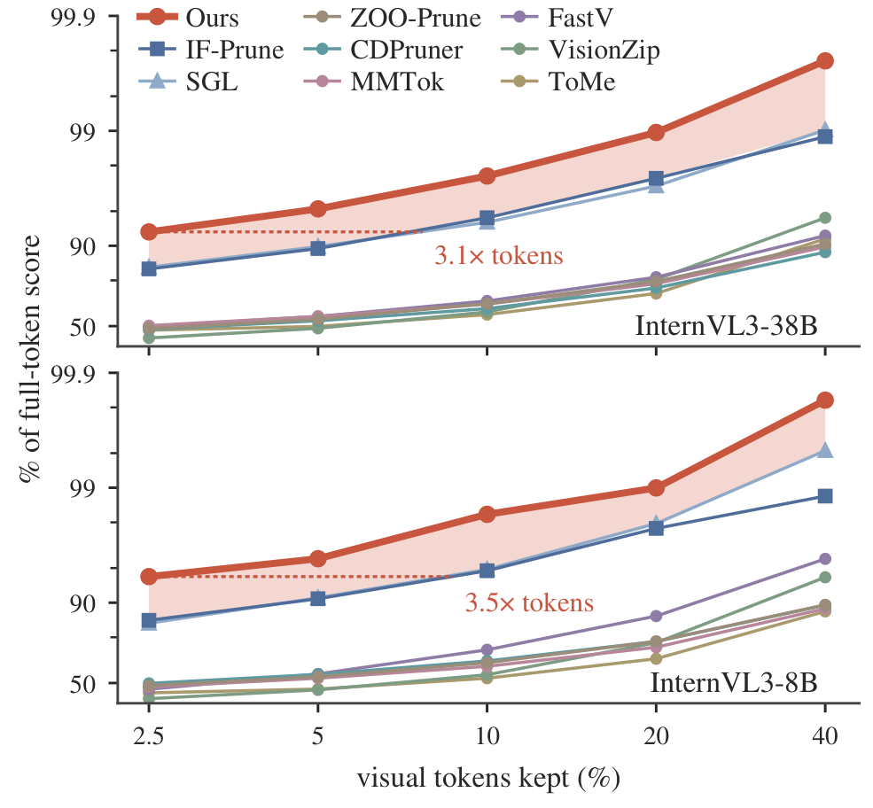

# Disagree to Prune: Reallocating Visual Tokens Where a Small VLM Dissents

Paper: [arXiv](https://arxiv.org/abs/2611.23807)  &nbsp;·&nbsp; [Citation](#citation)

Yanchao Li<sup>1,2</sup>, Jiaqing Xie<sup>3,2</sup>, Ben Gao<sup>4</sup>, Yusu Zhang<sup>5</sup>,
Beilun Wang<sup>6</sup>, Yanbo Wang<sup>7</sup>, Xiaohua Xu<sup>8</sup>, Zhongyu Huang<sup>2</sup>,
Tianfan Fu<sup>1,2,\*</sup>, Nanqing Dong<sup>2,9,\*</sup>

<sup>1</sup>Nanjing University, <sup>2</sup>Shanghai Artificial Intelligence Laboratory, <sup>3</sup>Fudan University,
<sup>4</sup>Wuhan University, <sup>5</sup>Shanghai Jiao Tong University, <sup>6</sup>Southeast University,
<sup>7</sup>North University of China, <sup>8</sup>University of Science and Technology of China,
<sup>9</sup>Shanghai Innovation Institute. <sup>\*</sup>Corresponding authors.

This repository holds the code and data of PRUDENT. Visual token pruning speeds up large vision-language models (VLMs)
by keeping only a part of their visual tokens. PRUDENT answers every question with about half of the budget. A small
VLM, the checker, answers the same question from the full image. The large VLM then re-answers with twice the budget
the questions on which the two answers disagree, up to a quota that keeps the average budget unchanged.

<p align="center"></p>

**PRUDENT and IF-Prune on two questions.** First answer and checker disagree, so the large VLM re-answers at 2K.
IF-Prune answers at K. Green boxes mark the evidence.

On 18 benchmarks, PRUDENT outperforms eight existing pruning methods at the same average budget of visual tokens.
Its lead widens as the budget tightens, and holds across five InternVL sizes. PRUDENT also has the highest average in
two more model families, Qwen3-VL and Gemma 4.

<p align="center"></p>

**PRUDENT (Ours) and eight existing pruning methods.** Each curve averages the five benchmarks that the IF-Prune and
SGL papers both report. The vertical axis is logarithmic in the share lost.

The repository has two parts.

- **Results and scripts that need no GPU.** The values behind every table and figure of the paper, the per-question
  results of every InternVL run, and scripts that recompute from them the main tables, the significance tests, the
  ablations, Figure 3b and the stream version of Appendix C.
- **Code that needs GPUs.** PRUDENT on InternVL3, the eight existing methods we compare with, and the runners for
  Qwen3-VL and Gemma 4. These are the scripts that produced the data.

## Contents

| Path | What it is |
|---|---|
| `data/perq/` | per-question results of every InternVL run (5 models, 18 benchmarks, 9 methods, all budgets) and of the checker, about 120 MB |
| `data/results/` | the values behind each table and figure of the paper, one CSV each (index below) |
| `data/prompts/` | the prompt of every question used by the Qwen3-VL and Gemma 4 runners |
| `prudent/` | the method. Benchmarks and budgets (`config.py`), answer matching (`answers.py`), scores (`scores.py`), the reallocation (`reallocate.py`), the paired bootstrap (`stats.py`) |
| `scripts/` | the runs (`run_*.sh`) and the scripts that make tables from runs or from `data/perq` (`make_*.py`) |
| `models/` | lmms-eval models of PRUDENT on InternVL (the guide's maps, the pruned large VLM, the checker) |
| `baselines/` | VisionZip, ToMe, CDPruner, MMTok and ZOO-Prune on InternVL, and the two-GPU loader of InternVL3-78B |
| `families/` | the runners for Qwen3-VL and Gemma 4, with their own `requirements.txt` |
| `tests/` | CPU checks of the token selection of the existing methods |
| `tasks/`, `patches/`, `setup.sh` | the lmms-eval tasks we added and our changes to IF-Prune's lmms-eval |

## Reproduce the tables without a GPU

These scripts read the per-question results in `data/perq` and need only Python with numpy, pandas and pyarrow
(the versions of `requirements.txt`), no GPU, no model weights and no lmms-eval.

```bash
python scripts/make_table.py --runs data/perq --significance   # Tables 1 and 2, significance of Appendix K
python scripts/make_ablation.py --runs data/perq               # Table 5
python scripts/make_failures.py --runs data/perq               # Figure 3b and the per-method table of Appendix J
python scripts/make_stream.py --runs data/perq                 # questions in a stream, Appendix C
python scripts/make_plugin.py --runs data/perq                 # IF-Prune or SGL ranks in both passes, Appendix L
python scripts/make_variants.py --runs data/perq               # stock-phrase questions kept (I), re-answering only disagreements (C)
```

Each script prints its table and can write it with `--out`. The main numbers are these.

| Script | Output | Value in the paper |
|---|---|---|
| `make_table.py` | Avg. of PRUDENT, InternVL3-38B at 2.5%, 5%, 10% | 88.4, 93.2, 96.4 |
| `make_table.py` | Avg. of PRUDENT, InternVL3-8B at 2.5%, 5%, 10% | 92.3, 95.1, 97.5 |
| `make_table.py --significance` | PRUDENT against each existing method, per setting | the marks of Appendix K |
| `make_ablation.py` | IF-Prune's ranking in both passes, text-rich, 2.5% | −7.8 |
| `make_failures.py` | the checker right on IF-Prune's failures at 2.5% | 70.5% |
| `make_stream.py` | the budget kept by the stream version | 97.7% to 100% of K |
| `make_plugin.py` | significant gains with IF-Prune's / SGL's ranking at 5% | 8 / 12 of 14 settings, none worse |
| `make_variants.py` | the budget used when only disagreements are re-answered | about 90% of K |

With the per-question results, every benchmark score, every existing method and every significance mark of Tables 1 and 2
(108 settings), every deterministic variant of Table 5, and the significance and plug-in tables of Appendices K and L
match the paper exactly. The random orders of Table 5 depend on the seed. With full
tokens, InternVL3-38B answers part of GQA and VQAv2 with a stock phrase (Appendix I), so its scores on these two
leave out those questions, while PRUDENT still selects among all of them (`prudent/config.py`).

## Data

`data/perq/<model>/<task>.parquet` holds one row per run and question.

| Column | Meaning |
|---|---|
| `run` | `<ranking or method>-r<fraction>`, as written by the run scripts |
| `doc_id` | the question's index in the lmms-eval task |
| `ans`, `score` | the normalized answer and its score under the benchmark's metric |
| `q` | the scoring unit (MMBench groups the rotated copies of a question, MME the two questions of an image) |
| `lp_first_p` or `lp_mean` | the confidence of the answer, the probability of the first token for option letters and the length-normalized log-probability otherwise |

The rankings and methods are `rankavg-sgp` (the guide's ranking), `single-ifp32` (IF-Prune, and full tokens at
fraction 1), `sgl`, `fastv`, `visionzip`, `tome`, `cdpruner`, `mmtok` and `zoo-prune`. `data/perq/checker/<task>.parquet`
holds the checker's answer, the log-probability of its least probable token (`min`) and its score.

`data/results/` holds the values behind each table and figure. `tables1-2_main.csv` is the output of
`make_table.py --significance`. In `table5_ablation.csv` and the files of Figure 5a to 5c, the rows of InternVL3-38B
on GQA and VQAv2 still count every question, as our runs logged them. The paper leaves out the stock-phrase questions
there, as `make_ablation.py` does for Table 5 and `appendixI_stock_phrase.csv` does for the main methods.

| Table or figure | File |
|---|---|
| Tables 1 and 2, Appendix K | `tables1-2_main.csv` |
| Table 3 | `table3_budget_1pct.csv` |
| Table 4, Appendix L | `table4_families.csv` |
| Table 5, Appendix N | `table5_ablation.csv` |
| Figure 1 | `figure1_frontier.csv`, `figure1_tokens_to_match.csv` |
| Figure 3a, Figure 5d to 5f | `figure3a_5d-f_evidence_per_question.csv` |
| Figure 3b, Appendix J | `figure3b_failures_per_method.csv`, `appendixJ_ifprune_per_benchmark.csv` |
| Figure 3c | `figure3c_detection_auroc.csv` |
| Figure 4a to 4f | `figure4a_threshold_and_repair.csv` to `figure4f_ceilings.csv` |
| Appendices G and H | `appendixG_grid_*.csv`, `appendixH_*.csv` |
| Figure 5a to 5c | `figure5a_sizes.csv`, `figure5b_rankings.csv`, `figure5c_*.csv` |
| Figure 5g to 5i | `figure5g_reanswered.csv`, `figure5h_loss_and_gain.csv`, `figure5i_categories.csv` |
| Appendices I and O | `appendixI_stock_phrase.csv`, `appendixO_reanswer_outcomes.csv` |
| Appendix L, IF-Prune or SGL ranks at 5% to 20% | `appendixL_plugin_by_budget.csv` (output of `make_plugin.py`) |

Some column names keep the names we used while running. `guide` is the guide's ranking, `reanswered` marks the questions
answered again, `abstained` the questions on which the checker abstains, and `PRUDENT` our method. `first` is the
fraction of the first pass and `b2` that of the re-answers. A `d_` column is a difference in points, and an asterisk
marks a paired bootstrap 95% interval that excludes zero.

## Run PRUDENT on InternVL3

1. Make an environment with Python 3.9 and CUDA 12.4, then
   `pip install -r requirements.txt --extra-index-url https://download.pytorch.org/whl/cu124`.
2. Run `bash setup.sh`. It clones IF-Prune at the commit we used into `third_party/IF-Prune`, applies our changes to
   its lmms-eval and adds our models and tasks. Then run `pip install -e third_party/IF-Prune/lmms-eval --no-deps` and
   `export IFPRUNE_REPO=$PWD/third_party/IF-Prune`.
3. The models come from the Hugging Face hub on first use. The large VLMs are `OpenGVLab/InternVL3-8B` and
   `OpenGVLab/InternVL3-38B` (`LARGE_CKPT` for a local path). The guide uses IF-Prune's estimator
   `ZachSun/internvl2_5_1b_pruning_kl_lora32` and the pre-trained `OpenGVLab/InternVL2_5-1B`. The checker is
   `OpenGVLab/InternVL3-2B`. `scripts/common.sh` lists the variables that change them.
4. The benchmarks are lmms-eval tasks, named in `prudent/config.py`, and lmms-eval fetches them from the hub.

```bash
bash scripts/run_all.sh InternVL3-8B chartqa                     # everything one benchmark needs at 2.5%, 5%, 10%
LIMIT=50 OUT=runs_check bash scripts/run_all.sh InternVL3-8B chartqa   # a quick check on 50 questions
python scripts/make_table.py --runs runs                         # the tables from these runs
```

`run_all.sh` runs the guide's two maps once per benchmark (`run_guide.sh`), the checker's answers from the full image
(`run_checker.sh`), and the large VLM at full tokens and at every fraction a budget needs (`run_large.sh`). These are
the first pass b, the re-answers 2K and one-pass pruning K, with b = K/2 except b = 1% at K = 2.5%. With greedy decoding,
answering every question at 2K and keeping the answers of the chosen questions gives the same answers as answering only
those again, so `make_table.py` makes the choice afterwards. `ABLATIONS=1` adds the runs of Table 5.

## Existing methods

```bash
bash scripts/run_baseline.sh InternVL3-8B chartqa visionzip 0.05
```

The methods are `ifprune`, `sgl`, `fastv`, `visionzip`, `tome`, `cdpruner`, `mmtok` and `zoo-prune`. Each keeps its
own ranking on the same large VLM, lmms-eval pipeline and answer logging as PRUDENT. IF-Prune, SGL and FastV read maps
of `run_guide.sh`, and FastV also reads the large VLM's own attention, which the script computes first. The other five
select their tokens in `baselines/`, which follows each method's official code. `python tests/test_baselines_cpu.py`
checks their token selection on random features. For InternVL3-78B, set `LARGE_SPLIT_CKPT` to its checkpoint to split
it over two GPUs.

## Other model families

`families/` runs Qwen3-VL (Qwen3-VL-2B as guide and checker for the 8B and 32B) and Gemma 4 (Gemma-4-E4B for the 31B)
in their own environment (`families/requirements.txt`, Python 3.11). The ranking is SGL's map of the small model.
`fam_run.py` and `fam_run2.py` give the answers of the text-rich and general benchmarks with full tokens and with the
kept tokens of each map, `fam_run3.py` with the existing methods of `fam_opp.py`, `fam_checker.py` the Qwen3-VL-4B
checker, and `fam_grid.py` the budget grid of Appendix G. Models are read from the Hugging Face cache (`HF_HOME`),
prompts from `data/prompts`, and outputs go to `$PRUDENT_OUT/families`. Their scores are in `data/results/table4_families.csv`.

## Notes

- Each run of InternVL3-8B or 38B uses one H200 GPU in bf16, InternVL3-78B two. Decoding is greedy, and each setting
  runs once.
- MMBench answers are matched offline (`LMMS_EVAL_NO_API=1`). DeepSeek-V4.1-Flash scores the open-ended answers of
  MM-Vet (Appendix I), whose results are in Appendix K.
- PRUDENT runs on IF-Prune's InternVL wrapper and lmms-eval copy. `setup.sh` fetches them, and this repository contains
  only our own files and our changes as a patch.
- The timed pipeline of Figure 5c measured every method on one implementation. Its measurements are in
  `data/results/figure5c_*.csv`.
  
## Citation

```bibtex
@misc{li2026disagreeprunereallocatingvisual,
      title={Disagree to Prune: Reallocating Visual Tokens Where a Small VLM Dissents}, 
      author={Yanchao Li and Jiaqing Xie and Ben Gao and Yusu Zhang and Beilun Wang and Yanbo Wang and Xiaohua Xu and Zhongyu Huang and Tianfan Fu and Nanqing Dong},
      year={2026},
      eprint={2611.22472},
      archivePrefix={arXiv},
      primaryClass={cs.CV},
      url={https://arxiv.org/abs/2611.22472}, 
}
```

## License and acknowledgments

The code is released under the Apache License 2.0 (`LICENSE`); `NOTICE` lists what it builds on. PRUDENT runs on
[IF-Prune](https://github.com/snap-research/EVLM-IF-Prune) and its copy of
[lmms-eval](https://github.com/EvolvingLMMs-Lab/lmms-eval). The existing methods follow the papers and official code of
VisionZip, ToMe, CDPruner, MMTok, ZOO-Prune, SGL and FastV. The models are InternVL, Qwen3-VL and Gemma. Model weights
and benchmark data keep their own licenses. We thank all of their authors for releasing their work.
